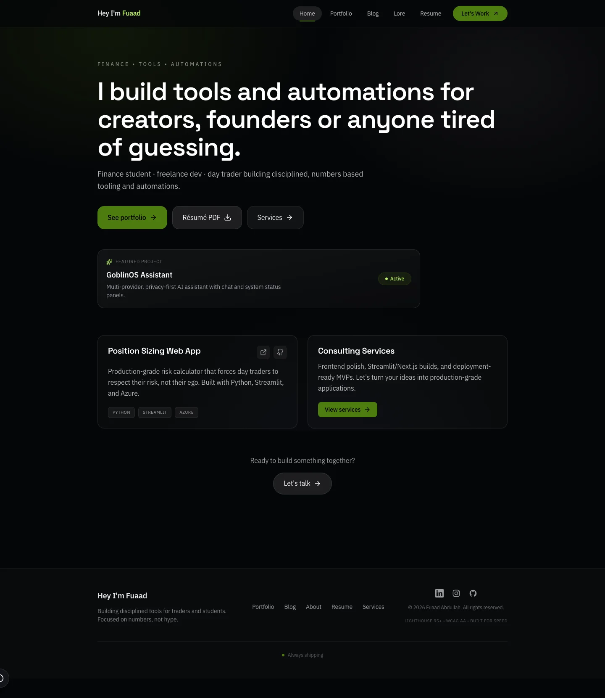
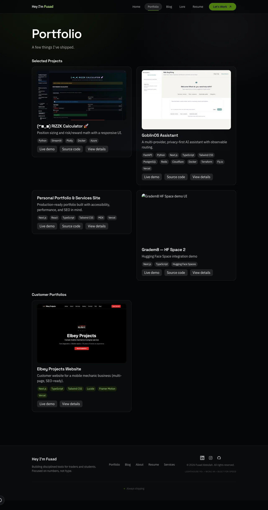
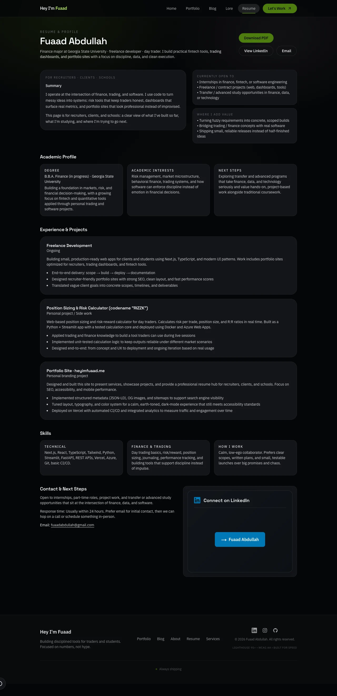

# Fuaad Portfolio

Production portfolio for Fuaad Abdullah, focused on employer-ready project presentation, case studies, and resume delivery.

## What this project does

- Presents selected engineering and fintech-adjacent projects with clear business and technical context.
- Publishes a resume page and downloadable PDF for applications and recruiter outreach.
- Includes a lightweight public portfolio assistant plus authenticated admin API docs.

## Screenshots





## Stack

- Next.js (App Router)
- React + TypeScript
- Tailwind CSS
- MDX content pipeline
- Vercel deployment

## Quickstart

```bash
corepack pnpm install
corepack pnpm dev
```

## Octopus CI migration (isolated)

An Octopus Cloud verification project is **prepared, not yet activated**. It targets the portfolio-only `Fuaad Portfolio CI` project and `Portfolio-CI` environment, not AyahOS's `Development` environment. Both TypeScript/lint/Vitest/build and Chromium Playwright E2E remain required. New Node-native isolation tests run separately via `pnpm ci:node-tests`.

Read [the Octopus rollout and rollback runbook](docs/ci/octopus-portfolio.md). GitHub-hosted Actions are **not retired** until a real exact-commit Octopus task proves both gates green and the dedicated webhook bridge posts `octopus/portfolio-ci=success`. The old GitHub Actions failures are currently an account-level runner billing lock, not failed application assertions.

## Quality checks

```bash
corepack pnpm typecheck
corepack pnpm lint
corepack pnpm test
```

## E2E tests (Playwright)

```bash
corepack pnpm exec playwright install chromium
corepack pnpm e2e
```

Optional debug commands:

```bash
corepack pnpm e2e:headed
corepack pnpm e2e:ui
corepack pnpm e2e:report
```

Current E2E scope (MVP):

- Route smoke checks for `/`, `/portfolio`, `/resume`, `/contact`, `/cv`
- Contact form happy-path submission (mocked `/api/contact` for deterministic UI validation)
- Resume and CV PDF link and response validation

## Key routes

- `/` home
- `/portfolio` project index
- `/resume` resume page
- `/api/mock-ai` public portfolio assistant
- `/api/ai` authenticated provider-backed assistant/admin endpoint
- `/api/contact` contact endpoint

## Docs

- [Architecture](docs/architecture.md)
- [Setup](docs/setup.md)
- [Impact](docs/impact.md)
- [External API Guide](docs/API.md)
- [OpenAPI Spec](docs/openapi.yaml)

## Contact

- Professional inquiries: https://heyimfuaad.me/contact
- LinkedIn: https://www.linkedin.com/in/fuaadabdullah
